Focused on systems hardening, network security, portable AI infrastructure, and practical IT. 
I learn how systems break by building them first—from raw TCP protocols to fault-tolerant clusters.

---

 

---

## 🎯 Featured Projects

  

---

## 🗺️ System Architecture

---

<!-- LOCAL & CLOUD AI GATEWAY SECTION (UNCOMMENT WHEN READY)

## 🖥️ Local & Cloud AI Gateway (`Assembly-AI-Tool`)

[SVG SLOT WHEN READY]:

A local-first AI interface engineered for cross-device portability and operational security.

| Capability | Details |
| :--- | :--- |
| **Unified Local + Cloud Routing** | Manages a portable `llama.cpp` server and online APIs through `LiteLLM` inside a green/red retro CRT dashboard. |
| **Operational Security** | Keeps sensitive code and configs local when needed, backed by strict pre-commit API key and metadata scrubbing. |
| **Planned Additions** | Real-time model loading progress bar, expanded token-usage analytics, and local file uploads. |

> *Running models locally keeps sensitive code and API keys under your own control.*

Assembly-AI-Tool roadmap

 

| Status | Milestone |
| :---: | :--- |
| ✅ | Portable USB `llama.cpp` server across Windows hosts |
| ✅ | RAM-tiered GGUF model routing (`7B` vs `30B-A3B`) |
| ✅ | Retro green/red web dashboard with `LiteLLM` routing |
| ⬜ | Real-time model loading progress bar |
| ⬜ | Expanded per-conversation & cumulative token analytics |
| ⬜ | Local file upload & context ingestion |

---

-->

## 💼 Open to Opportunities

  

---

  

